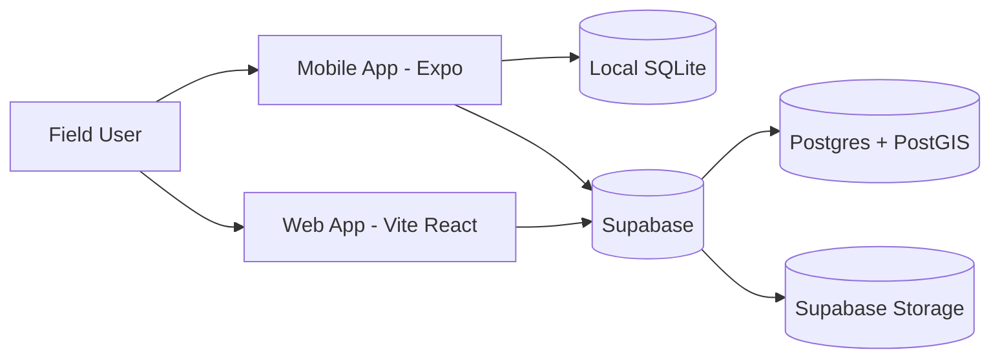
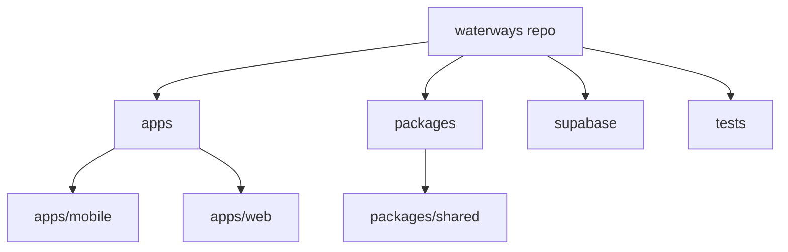
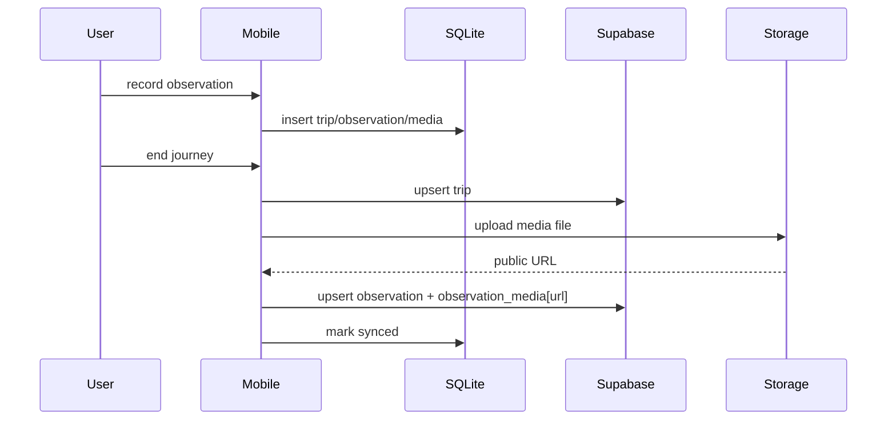
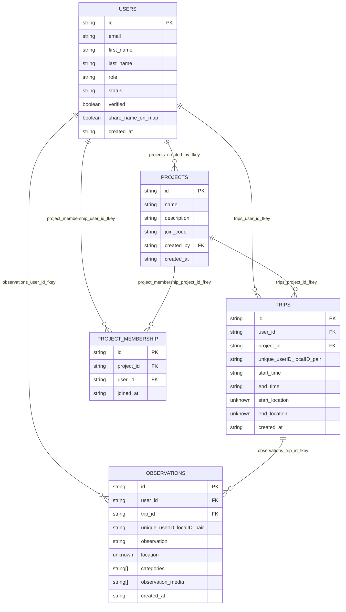
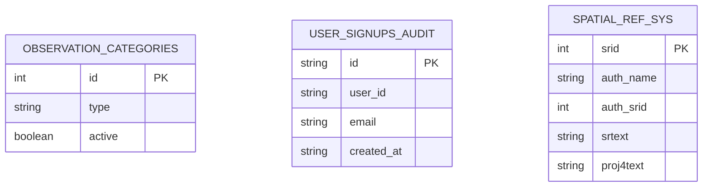

# Waterways Architecture

This document explains the current project architecture and data flow.

Schema diagrams in this file are derived from Supabase generated types in `packages/shared/src/models/database-types.ts` (`Database['public']['Tables']`).

## High-level system



## Monorepo layout



## Mobile sync model (offline-first)

- Mobile writes trips/observations/media to local SQLite first.
- Sync uploads trips and observations to Supabase.
- Media is uploaded to Supabase Storage buckets:
  - `Images` (photos)
  - `Vidoes` (videos)
- Observation payload includes media URL list in `observation_media`.



## Supabase data model (from generated types)

The ER diagrams below reflect the current `public` tables and relationships defined in generated Supabase types.

### Core relational graph



### Additional public tables



### Relationship inventory (exact FK names)

- `observations_trip_id_fkey`: `observations.trip_id -> trips.id`
- `observations_user_id_fkey`: `observations.user_id -> users.id`
- `project_membership_project_id_fkey`: `project_membership.project_id -> projects.id`
- `project_membership_user_id_fkey`: `project_membership.user_id -> users.id`
- `projects_created_by_fkey`: `projects.created_by -> users.id`
- `trips_project_id_fkey`: `trips.project_id -> projects.id`
- `trips_user_id_fkey`: `trips.user_id -> users.id`

### Notes about type fidelity

- Column nullability and runtime value shape come from `Row` types in generated definitions.
- `location`, `start_location`, and `end_location` are typed as `unknown` in generated output.
- `categories` and `observation_media` are typed as string arrays.
- These diagrams intentionally model Supabase tables only (not local SQLite tables).

## Rendering Mermaid in VS Code

### Option A: built-in markdown preview

1. Open this file in VS Code.
2. Run `Markdown: Open Preview` (`Ctrl+Shift+V`) or `Markdown: Open Preview to the Side` (`Ctrl+K V`).
3. Mermaid blocks render directly in the preview pane.

### Option B: use a Mermaid preview extension

If your environment does not render Mermaid in markdown preview, install one extension:

- `bierner.markdown-mermaid` (Markdown Preview Mermaid Support)

Then reopen markdown preview.

### Exporting rendered diagrams

- Use the preview pane and run `Markdown: Print` for PDF export, or use a screenshot tool for PNG capture.
- Keep diagrams in fenced code blocks starting with ```mermaid so both built-in and extension renderers detect them.

## Runtime notes

- Expo Go is used for normal dev iteration.
- Wake-word availability depends on runtime/native module support.
- Supabase generated types are stored in:
  - `packages/shared/src/models/database-types.ts`

## Important boundaries

- `packages/shared` contains common models/supabase types/utilities.
- `apps/mobile` owns local-db and sync orchestration.
- `apps/web` consumes Supabase-hosted data for browser UX.
