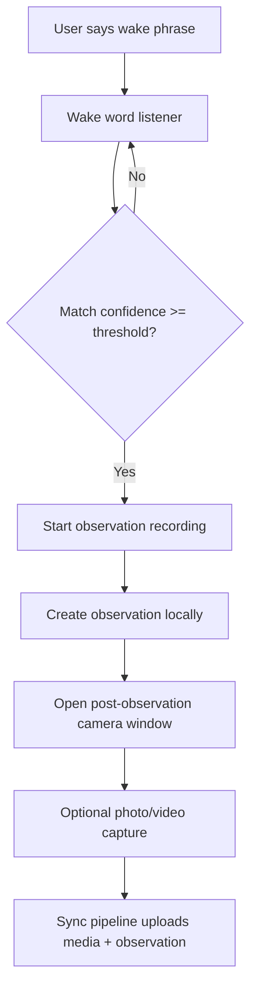
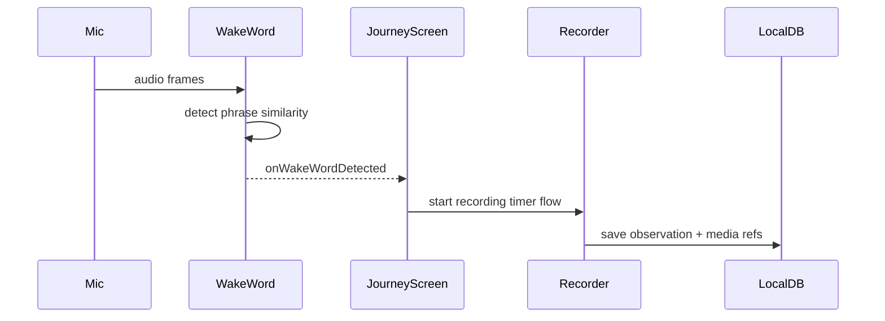
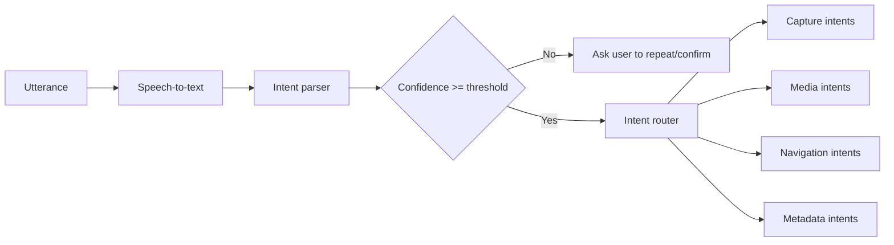

# Wake Word System

This is the single source of truth for wake-word behavior and future voice-to-intent expansion.

## Current objective

Enable hands-free observation capture during active field journeys while keeping reliability high in noisy environments.

## Current flow

## Runtime behavior

- Wake-word listening is enabled only where native/runtime support is available.
- In Expo Go, wake word is disabled and UI shows informational text.
- Observation capture still works through the standard Start Observation control.

## Signal path (conceptual)

## Voice-to-intent expansion plan

Goal: map natural speech to explicit in-app intents after wake word (and eventually without explicit wake word in controlled contexts).

### Proposed intent pipeline

### Initial intents to implement

- Media intents (post-observation):
  - "take a photo"
  - "take a video"
  - "retake photo"
  - "stop video"
- Observation intents:
  - "start observation"
  - "stop recording"
  - "tag as erosion"
- Navigation intents:
  - "open review"
  - "end journey"

### Example mapping table

| Example phrase | Intent | Parameters |
|---|---|---|
| "take a video" | `media.capture` | `mode=video` |
| "take a photo" | `media.capture` | `mode=photo` |
| "stop recording" | `observation.stop` | none |
| "tag as algae" | `observation.tag` | `category=algae` |

## Recommended implementation phases

1. **Deterministic command grammar** for top-priority intents (`take photo`, `take video`).
2. **Intent confidence + confirmation UX** for ambiguous phrases.
3. **Context-aware intent routing** (e.g., only allow `take video` during camera window).
4. **Telemetry and analytics** on intent success/failure for iteration.

## Guardrails

- Always provide a touch fallback for every voice path.
- Keep destructive actions behind confirmation.
- Log intent classification results for debugging and QA.
